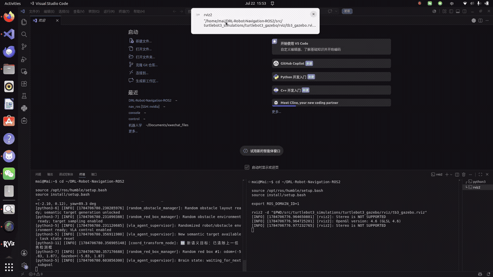
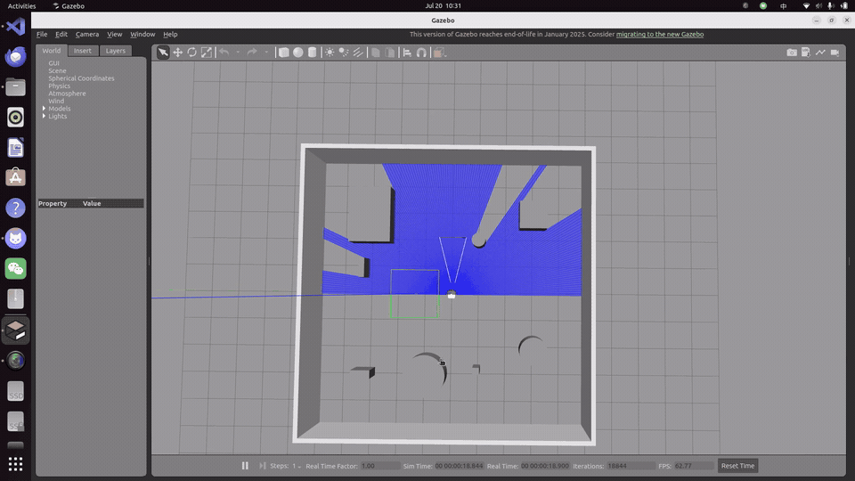
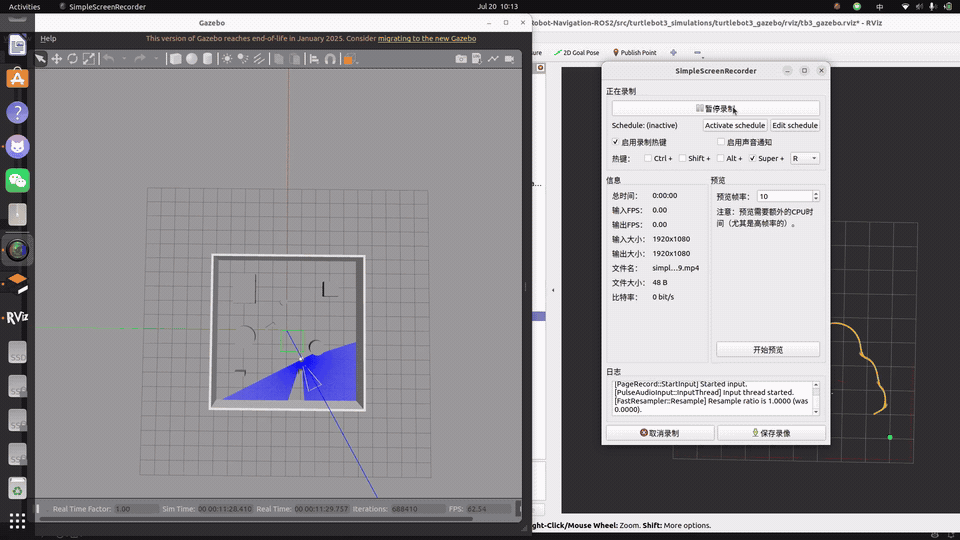
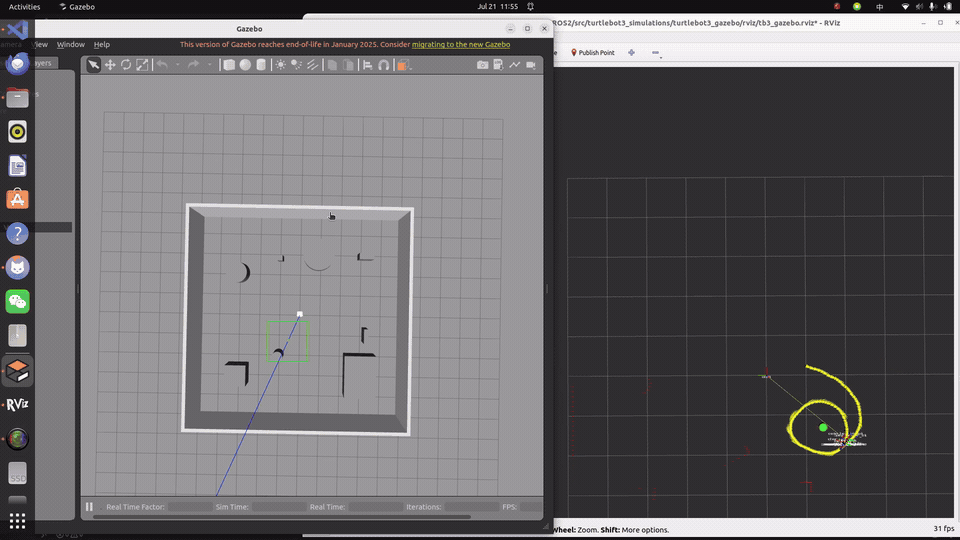

# Vision-Language Guided Reinforcement Learning Navigation System

ROS 2 + Gazebo research code for vision-language-guided mobile robot navigation. The project combines a Qwen-VL high-level goal planner, a Soft Actor-Critic (SAC) local controller, and an optional LiDAR-based safety shield for TurtleBot3 Waffle navigation in cluttered simulated environments.

The released deterministic policy is stored in `src/drl_navigation_ros2/models/SAC_epoch6_best`.

## Project Snapshot

| Component | Implementation |
| --- | --- |
| Robot platform | TurtleBot3 Waffle |
| Simulator | Gazebo Classic 11 |
| Middleware | ROS 2 Humble |
| Local policy | Soft Actor-Critic |
| Semantic planner | Qwen-VL through the VLA bridge |
| Policy observations | LaserScan, Odometry, relative target, previous action |
| Final command topic | `/cmd_vel` |
| Shielded policy topic | `/policy_cmd_vel` |
| Goal interface | `/vla_goal` as `geometry_msgs/PointStamped` in the `odom` frame |

## Main Demo

The trained SAC policy runs deterministic inference in Gazebo while using LiDAR observations for local obstacle avoidance and a target goal for navigation.

<p align="center">
  
</p>

## What To Observe

This repository is organized for academic project review. When evaluating the demo and code, focus on the following observable behaviors:

| Observation | Where to verify |
| --- | --- |
| The robot is trained and tested inside the same ROS 2 + Gazebo workflow | `src/drl_navigation_ros2/train.py`, `src/drl_navigation_ros2/ros_python.py`, training GIF |
| SAC receives local geometric state rather than raw video | LaserScan, Odometry, relative goal, previous-action state construction |
| VLA reasoning is separated from low-level control | `src/vla_bridge/vla_bridge/`, `/vla_goal/source/*`, `vla_agent_supervisor.py` |
| The safety shield is policy-independent | `safety_shield.py`, `safety_shield_core.py`, `/policy_cmd_vel` to `/cmd_vel` projection |
| Training improves navigation behavior | untrained-policy GIF versus trained-policy GIF |
| Results are presented conservatively | `docs/EXPERIMENT_RESULTS.md` records pending metrics separately from visual demos |

## Demo Sequence

The four GIFs below form the project demonstration chain: environment setup, untrained baseline behavior, SAC training interaction, and trained policy inference.

### 1. Simulation Environment

Gazebo Classic environment with TurtleBot3 Waffle, randomized obstacles, goal locations, LiDAR perception, and multiple observation views.

<p align="center">
  
</p>

### 2. Before Training - Untrained Policy Behavior

Before SAC training, the robot exhibits unstable exploration, repeated local turns, inefficient trajectories, and weak goal-directed behavior.

<p align="center">
  
</p>

### 3. SAC Training Process

During training, the SAC agent continuously interacts with the Gazebo environment, collects observations, samples actions, and updates the navigation policy across episodes.

<p align="center">
  
</p>

### 4. After Training - Learned Navigation Policy

After training, the deterministic policy demonstrates more goal-directed navigation while reacting to obstacles through local LiDAR-based observations.

<p align="center">
  
</p>

## Motivation

Autonomous robots require the ability to understand high-level human instructions and execute safe low-level navigation. This is difficult because semantic reasoning and collision-aware control operate at different frequencies and levels of abstraction. A vision-language model can identify a target object or infer navigation intent, but direct velocity control from the model is brittle in cluttered indoor environments.

This project studies a hierarchical architecture:

- A low-frequency Qwen-VL planner interprets scene/task information and publishes candidate goals.
- A high-frequency SAC policy consumes LiDAR, odometry, and the active goal to publish velocity commands.
- An optional, policy-independent LiDAR safety shield projects unsafe actions to stop, reduced-speed, or avoidance commands.

The result is a reproducible ROS 2 navigation stack for studying semantic goal grounding, reinforcement-learning local control, and safety intervention in Gazebo.

## Method

### Architecture

```text
          Qwen-VL
             |
  Natural Language Command
             |
       Goal Reasoning
             |
       Navigation Target
             |
     Goal Supervisor
             |
          SAC Agent <----- LiDAR + Odometry
             |
      /policy_cmd_vel
             |
       Safety Shield <----- LiDAR
             |
         /cmd_vel
             |
        TurtleBot3
             |
          Gazebo
```

Qwen-VL and the VLA bridge publish navigation goals through `/vla_goal/source/*`. The supervisor selects and normalizes a goal on `/vla_goal`. In the shield configuration, `sac_vla_controller` publishes raw policy actions on `/policy_cmd_vel`, while the independent `safety_shield` node is the only publisher on `/cmd_vel`. VLA components never directly command velocity.

### Reinforcement Learning Policy

The local navigation policy is trained with SAC using:

- LaserScan observations from TurtleBot3.
- Odometry-derived relative target features.
- Previous action context.
- Reward terms for goal progress, goal completion, collision, timeout, and inefficient motion.

Training entry point: `src/drl_navigation_ros2/train.py`.

Deterministic inference entry point: `src/drl_navigation_ros2/inference.py`.

### Policy Action Safety Shield

Inspired by policy-action shielding, the ROS 2 adaptation remains independent of the SAC network and uses LiDAR geometry at control frequency. It applies:

- emergency stop when any valid range is critically close;
- zero-linear-speed turning toward the clearer side for a blocked front sector;
- continuous forward-speed reduction inside the warning region;
- pass-through when the policy action is safe.

The shield publishes `/safety_shield/status` and `/safety_shield/intervention`, enabling intervention-rate and collision-rate analysis without changing the trained policy.

### VLA Goal Grounding

The VLA stack is integrated under `src/vla_bridge/vla_bridge`. Demo nodes can publish semantic observations, detection results, or target poses. These candidate goals are normalized through source topics and then selected by `vla_agent_supervisor.py`.

Goal priority:

```text
manual > demo6 target pose > vision detection fallback
```

The full launch file is:

```text
src/turtlebot3_simulations/turtlebot3_gazebo/launch/vla_sac_stack.launch.py
```

## Repository Layout

| Path | Purpose |
| --- | --- |
| `src/drl_navigation_ros2/train.py` | SAC training script |
| `src/drl_navigation_ros2/inference.py` | SAC/VLA inference controller |
| `src/drl_navigation_ros2/safety_shield.py` | Independent ROS 2 action safety shield |
| `src/drl_navigation_ros2/safety_shield_core.py` | Testable LiDAR safety projection |
| `src/drl_navigation_ros2/ros_python.py` | Gazebo environment, state construction, rewards |
| `src/drl_navigation_ros2/SAC/` | SAC actor, critic, replay buffer, update logic |
| `src/drl_navigation_ros2/models/SAC_epoch6_best/` | Released stable inference checkpoint |
| `src/drl_navigation_ros2/vla_agent_supervisor.py` | Goal arbitration and fallback behavior |
| `src/drl_navigation_ros2/random_obstacle_manager.py` | Randomized obstacle spawning |
| `src/drl_navigation_ros2/random_red_box_manager.py` | Random semantic target spawning |
| `src/vla_bridge/vla_bridge/` | Demo4/Demo5/Demo6 VLA bridge nodes |
| `docs/assets/` | README GIF demonstrations |
| `docs/PROJECT_LAYOUT.md` | Detailed file map |
| `docs/EXPERIMENT_RESULTS.md` | Current metric log and evaluation protocol |

## Experimental Results

The current released model is `SAC_epoch6_best`. Latest tracked metrics and the evaluation template are maintained in:

```text
docs/EXPERIMENT_RESULTS.md
```

The table below defines the planned comparison. Values should be filled only after all methods are evaluated with the same seeds, maps, checkpoint policy, and episode count.

| Method | Episodes | Success Rate | Collisions | Mean Time | Status |
| --- | ---: | ---: | ---: | ---: | --- |
| DWA | TBD | TBD | TBD | TBD | Evaluation pending |
| SAC | TBD | TBD | TBD | TBD | Evaluation pending |
| VLA + SAC | TBD | TBD | TBD | TBD | Evaluation pending |
| VLA + SAC + Safety Shield | TBD | TBD | TBD | TBD | Evaluation pending |

See [the experiment log](docs/EXPERIMENT_RESULTS.md) for metric definitions, safety-shield ablation design, and the verified-results table.

## Installation

Tested target environment:

- Ubuntu 22.04
- ROS 2 Humble
- Gazebo Classic 11
- Python 3.10
- PyTorch

Install system dependencies:

```bash
sudo apt update
sudo apt install -y \
  python3-colcon-common-extensions \
  python3-rosdep \
  ros-humble-gazebo-ros-pkgs
```

Install Python dependencies into a project-local directory:

```bash
cd ~/DRL-Robot-Navigation-ROS2
python3 -m pip install --target .python_deps \
  numpy pyyaml tqdm tensorboard squaternion torch dashscope opencv-python
```

Build the ROS 2 workspace:

```bash
cd ~/DRL-Robot-Navigation-ROS2
source /opt/ros/humble/setup.bash
rosdep install --from-paths src --ignore-src --rosdistro humble -y
colcon build --symlink-install --allow-overriding turtlebot3_description
source install/setup.bash
```

## Training

Terminal 1:

```bash
cd ~/DRL-Robot-Navigation-ROS2
source /opt/ros/humble/setup.bash
source install/setup.bash

export ROS_DOMAIN_ID=1
export DRLNAV_BASE_PATH="$PWD"
export TURTLEBOT3_MODEL=waffle
export GAZEBO_MODEL_PATH="$PWD/src/turtlebot3_simulations/turtlebot3_gazebo/models:${GAZEBO_MODEL_PATH:-}"

ros2 launch turtlebot3_gazebo ros2_drl.launch.py
```

Terminal 2:

```bash
cd ~/DRL-Robot-Navigation-ROS2
source /opt/ros/humble/setup.bash
source install/setup.bash

export ROS_DOMAIN_ID=1
export DRLNAV_BASE_PATH="$PWD"
export TURTLEBOT3_MODEL=waffle
export PYTHONPATH="$PWD/.python_deps:$PWD/src:$PWD/src/drl_navigation_ros2:${PYTHONPATH:-}"

mkdir -p src/drl_navigation_ros2/models/SAC
python3 src/drl_navigation_ros2/train.py
```

Resume from a checkpoint:

```bash
python3 src/drl_navigation_ros2/train.py --resume
```

TensorBoard:

```bash
cd ~/DRL-Robot-Navigation-ROS2
export PYTHONPATH="$PWD/.python_deps:${PYTHONPATH:-}"
export PATH="$PWD/.python_deps/bin:${PATH:-}"
tensorboard --logdir runs --host 0.0.0.0 --port 6006
```

## Inference

Start Gazebo, then run deterministic SAC inference:

```bash
cd ~/DRL-Robot-Navigation-ROS2
source /opt/ros/humble/setup.bash
source install/setup.bash

export ROS_DOMAIN_ID=1
export DRLNAV_BASE_PATH="$PWD"
export TURTLEBOT3_MODEL=waffle
export PYTHONPATH="$PWD/.python_deps:$PWD/src:$PWD/src/drl_navigation_ros2:${PYTHONPATH:-}"

python3 src/drl_navigation_ros2/inference.py
```

Publish a manual odom-frame goal:

```bash
python3 src/drl_navigation_ros2/publish_vla_goal.py 1.0 0.0 --topic /vla_goal
```

Check runtime topics:

```bash
ros2 topic echo /sac_navigation/status
ros2 topic echo /cmd_vel --once
```

## Full VLA + SAC Stack

```bash
cd ~/DRL-Robot-Navigation-ROS2
source /opt/ros/humble/setup.bash
source install/setup.bash

export ROS_DOMAIN_ID=1
export DRLNAV_BASE_PATH="$PWD"
export TURTLEBOT3_MODEL=waffle
export GAZEBO_MODEL_PATH="$PWD/src/turtlebot3_simulations/turtlebot3_gazebo/models:${GAZEBO_MODEL_PATH:-}"
export PYTHONPATH="$PWD/.python_deps:$PWD/src:$PWD/src/drl_navigation_ros2:$PWD/src/vla_bridge:${PYTHONPATH:-}"

export DASHSCOPE_API_KEY="your_dashscope_api_key"
export BPX_QWEN_VL_MODEL=qwen3-vl-32b-thinking

ros2 launch turtlebot3_gazebo vla_sac_stack.launch.py \
  target_mode:=demo6 \
  start_gazebo:=true \
  start_random_obstacles:=true \
  start_random_target:=true \
  start_demo4:=true \
  start_demo5:=true \
  start_demo6:=true \
  start_task_adapter:=true \
  enable_color_fallback:=true \
  policy_speed_scale:=0.60 \
  search_angular_speed:=0.35 \
  search_rotate_duration:=60.0 \
  search_observe_duration:=0.0 \
  search_duration:=60.0 \
  episode_timeout:=120.0 \
  demo5_detect_rate:=0.2 \
  vlm_model:=qwen3-vl-32b-thinking
```

Useful checks:

```bash
ros2 topic echo /vla/detection/bbox
ros2 topic echo /vla/target/map_pose
ros2 topic echo /vla_goal
ros2 topic echo /sac_navigation/status
ros2 topic echo /vla_navigation/result --qos-durability transient_local
ros2 topic info /cmd_vel -v
```

## Citation

If this repository supports your academic work, cite it using [CITATION.bib](CITATION.bib). Please also cite the underlying SAC, TurtleBot3, ROS 2, and Gazebo components used by your experiment.

## Acknowledgements

This project builds on ROS 2, Gazebo Classic, TurtleBot3 simulation assets, SAC implementations, and earlier DRL navigation examples.

Related references:

- <https://github.com/tomasvr/turtlebot3_drlnav>
- <https://github.com/reiniscimurs/DRL-robot-navigation>
- <https://github.com/denisyarats/pytorch_sac>

## License

This repository is released under the MIT License. See `LICENSE` for details.
