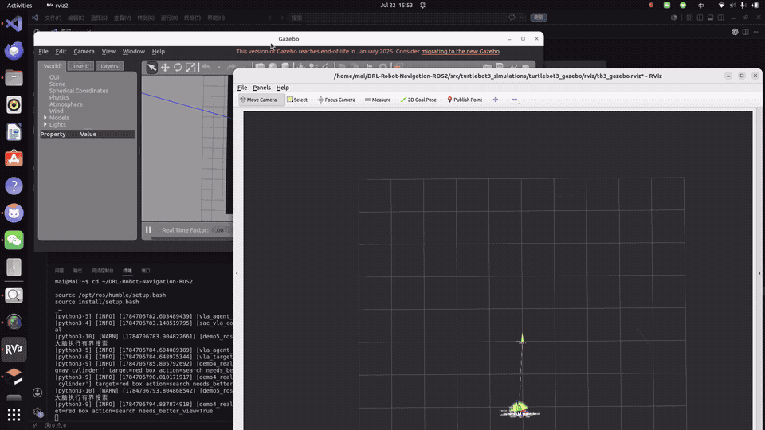

# Vision-Language-Guided DRL Navigation for ROS 2

**MAI Yunxi** | ROS 2 Humble | Soft Actor-Critic | VLA goal grounding | LiDAR safety

A research prototype that separates semantic goal selection from real-time robot control. Qwen-VL-derived targets enter through a typed ROS 2 goal interface; a SAC policy handles local motion, while an independent LiDAR shield can override unsafe actions.

[](docs/media/drl_simulation_sequence.mp4)

**[Open the 20-second H.264 demo](docs/media/drl_simulation_sequence.mp4)** | [Environment](docs/media/simulation_environment.gif) | [Before training](docs/media/before_training.gif) | [Training interaction](docs/media/during_training.gif)

The media demonstrates the simulation workflow and qualitative policy behaviour. It is not a substitute for the controlled metrics that remain [pending](docs/EXPERIMENT_RESULTS.md).

## My Contribution

- Built the ROS 2 inference path that combines `LaserScan`, odometry, a relative goal and previous action into the same 25-dimensional state used by the released policy: [`inference.py`](src/drl_navigation_ros2/inference.py).
- Designed goal arbitration so semantic components publish `PointStamped` targets rather than velocity commands: [`vla_agent_supervisor.py`](src/drl_navigation_ros2/vla_agent_supervisor.py) and [`vla_bridge`](src/vla_bridge/vla_bridge/).
- Added a policy-independent LiDAR action shield with timeout handling, observable intervention states and pure-Python unit tests: [`safety_shield.py`](src/drl_navigation_ros2/safety_shield.py), [`safety_shield_core.py`](src/drl_navigation_ros2/safety_shield_core.py), and [`test_safety_shield_core.py`](tests/test_safety_shield_core.py).
- Integrated the controller, safety ownership and optional VLA nodes in one launch path: [`vla_sac_stack.launch.py`](src/turtlebot3_simulations/turtlebot3_gazebo/launch/vla_sac_stack.launch.py).

## System Architecture

```mermaid
flowchart LR
    NL[Natural-language task] --> VLM[Qwen-VL / vision bridge]
    VLM --> CAND[/vla_goal/source/*]
    CAND --> SUP[Goal supervisor]
    SUP --> GOAL[/vla_goal: PointStamped in odom]
    SCAN[/scan] --> SAC[SAC local controller]
    ODOM[/odom] --> SAC
    GOAL --> SAC
    SAC --> POLICY[/policy_cmd_vel]
    POLICY --> SHIELD[Independent LiDAR shield]
    SCAN --> SHIELD
    SHIELD --> CMD[/cmd_vel]
    CMD --> TB3[TurtleBot3 Waffle in Gazebo]
```

The semantic layer never publishes wheel velocity. With the shield enabled, the SAC controller is moved to `/policy_cmd_vel`, and the shield becomes the sole final publisher on `/cmd_vel`.

## Engineering Decisions

| Decision | Why it matters | Evidence |
| --- | --- | --- |
| Semantic goal is not a velocity command | Keeps slow, uncertain VLM reasoning outside the control loop | [Goal supervisor](src/drl_navigation_ros2/vla_agent_supervisor.py) |
| One final velocity owner | Prevents competing controllers from writing `/cmd_vel` | [Launch wiring](src/turtlebot3_simulations/turtlebot3_gazebo/launch/vla_sac_stack.launch.py) |
| Shield is independent of SAC weights | Enables a controlled shield/no-shield comparison | [Shield core](src/drl_navigation_ros2/safety_shield_core.py) |
| Inference validates checkpoint schema | Detects state/weight mismatch before commanding the robot | [Policy loader](src/drl_navigation_ros2/inference.py) |
| Claims remain evidence-bounded | Qualitative demos are separated from unrun benchmarks | [Experiment log](docs/EXPERIMENT_RESULTS.md) |

## Evidence Status

| Item | Status |
| --- | --- |
| ROS 2 + Gazebo training/inference workflow | Code and visual evidence included |
| Released deterministic checkpoint | Included at `src/drl_navigation_ros2/models/SAC_epoch6_best` |
| Safety-shield behaviour | Pure-Python tests included |
| DWA/SAC/VLA/shield comparison | Pending controlled evaluation |
| Success, collision and completion-time claims | Not claimed without saved outputs |
| Physical-robot deployment | Not claimed; this repository is simulation-based |

The next experiment is a fixed-seed ablation of SAC versus SAC + shield with identical maps, goals, timeouts and checkpoint. See [the protocol](docs/EXPERIMENT_RESULTS.md).

## Minimal Reproduction

Tested target: Ubuntu 22.04, ROS 2 Humble, Gazebo Classic 11, Python 3.10 and TurtleBot3 Waffle.

```bash
git clone https://github.com/maiyunxi173-afk/DRL_VLA_NAVIGATION_ROS2.git
cd DRL_VLA_NAVIGATION_ROS2
source /opt/ros/humble/setup.bash
rosdep install --from-paths src --ignore-src --rosdistro humble -y
colcon build --symlink-install --allow-overriding turtlebot3_description
source install/setup.bash
```

Run Gazebo and the deterministic policy:

```bash
export ROS_DOMAIN_ID=1
export DRLNAV_BASE_PATH="$PWD"
export TURTLEBOT3_MODEL=waffle
export GAZEBO_MODEL_PATH="$PWD/src/turtlebot3_simulations/turtlebot3_gazebo/models:${GAZEBO_MODEL_PATH:-}"
export PYTHONPATH="$PWD/src:$PWD/src/drl_navigation_ros2:${PYTHONPATH:-}"

ros2 launch turtlebot3_gazebo ros2_drl.launch.py
# In a second sourced terminal:
python3 src/drl_navigation_ros2/inference.py
```

Pure-Python safety test:

```bash
python3 -m pytest -q tests/test_safety_shield_core.py
```

ROS-dependent tests require a sourced ROS 2 environment. Full training, VLA launch and dependency commands are in [Reproduction Guide](docs/REPRODUCTION.md).

## Scope and Attribution

This repository adapts ROS 2, Gazebo Classic, TurtleBot3 assets, SAC implementations and earlier DRL-navigation examples. Upstream references are listed in [Source Attribution](docs/SOURCE_ATTRIBUTION.md); the repository's original material is MIT-licensed, while retained upstream files keep their own notices.

## Review Paths

- [Reproduction and launch guide](docs/REPRODUCTION.md)
- [Experiment protocol and pending metrics](docs/EXPERIMENT_RESULTS.md)
- [Detailed repository map](docs/PROJECT_LAYOUT.md)
- [Media integrity check](scripts/check_media.py)
- [Citation](CITATION.bib)

**Contact:** [MAI Yunxi](https://github.com/maiyunxi173-afk)
